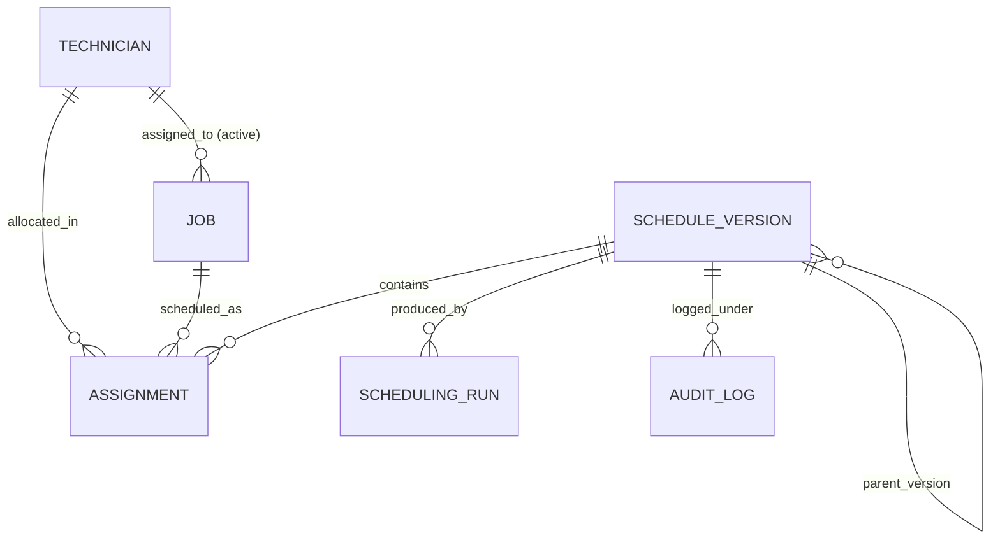

# DISPATCHGRID — Database Schema & Constraints Specification

## 1. Entity Relationship Overview

DISPATCHGRID uses PostgreSQL with SQLAlchemy 2.0 (`Mapped` / `mapped_column`) and timezone-aware `TIMESTAMPTZ` columns (`DateTime(timezone=True)`). List and structured metadata columns use `JSON().with_variant(JSONB, "postgresql")`.

---

## 2. Table Definitions

### A. `technicians` (`app/models/technician.py`)
| Column | Type | Nullable | Default | Constraints / Indexes |
| :--- | :--- | :---: | :---: | :--- |
| `id` | `UUID` | No | `uuid4()` | Primary Key |
| `name` | `VARCHAR(150)` | No | — | Indexed |
| `phone` | `VARCHAR(32)` | Yes | `NULL` | — |
| `skills` | `JSONB` | No | `[]` | Non-empty list of electrical skills |
| `service_zones` | `JSONB` | No | `[]` | Non-empty list of service zone codes |
| `latitude` | `FLOAT` | No | — | `CheckConstraint("-90.0 <= latitude <= 90.0")` |
| `longitude` | `FLOAT` | No | — | `CheckConstraint("-180.0 <= longitude <= 180.0")` |
| `shift_start` | `TIME` | No | — | Shift start time (local service zone time) |
| `shift_end` | `TIME` | No | — | Shift end time |
| `is_active` | `BOOLEAN` | No | `True` | Indexed |
| `availability_status` | `VARCHAR(32)` | No | `'AVAILABLE'` | Indexed; `AVAILABLE`, `BUSY`, `ON_BREAK`, `UNAVAILABLE`, `OFF_DUTY` |
| `unavailable_windows` | `JSONB` | No | `[]` | Time-aware break / unavailable intervals `[{start, end, status, reason}]` |
| `created_at` | `TIMESTAMPTZ` | No | `now(UTC)` | — |
| `updated_at` | `TIMESTAMPTZ` | No | `now(UTC)` | Auto-updated on change |

### B. `jobs` (`app/models/job.py`)
| Column | Type | Nullable | Default | Constraints / Indexes |
| :--- | :--- | :---: | :---: | :--- |
| `id` | `UUID` | No | `uuid4()` | Primary Key |
| `customer_name` | `VARCHAR(200)` | No | — | — |
| `customer_contact` | `VARCHAR(64)` | Yes | `NULL` | — |
| `job_type` | `VARCHAR(100)` | No | — | Indexed |
| `description` | `TEXT` | No | — | — |
| `required_skills` | `JSONB` | No | `[]` | Non-empty list of required electrical skills |
| `priority` | `VARCHAR(32)` | No | `'MEDIUM'` | Indexed; `LOW`, `MEDIUM`, `HIGH`, `CRITICAL` |
| `status` | `VARCHAR(32)` | No | `'PENDING'` | Indexed; `PENDING`, `ASSIGNED`, `IN_PROGRESS`, `COMPLETED`, `CANCELLED`, `UNASSIGNED` |
| `latitude` | `FLOAT` | No | — | `CheckConstraint("-90.0 <= latitude <= 90.0")` |
| `longitude` | `FLOAT` | No | — | `CheckConstraint("-180.0 <= longitude <= 180.0")` |
| `service_zone` | `VARCHAR(100)` | No | — | Indexed |
| `estimated_duration_minutes` | `INTEGER` | No | — | `CheckConstraint("estimated_duration_minutes > 0")` |
| `appointment_window_start` | `TIMESTAMPTZ` | No | — | Indexed |
| `appointment_window_end` | `TIMESTAMPTZ` | No | — | `CheckConstraint("appointment_window_end > appointment_window_start")` |
| `sla_deadline` | `TIMESTAMPTZ` | No | — | Indexed |
| `assigned_technician_id` | `UUID` | Yes | `NULL` | `ForeignKey("technicians.id", ondelete="SET NULL")`, Indexed |
| `actual_start_time` | `TIMESTAMPTZ` | Yes | `NULL` | — |
| `actual_completion_time` | `TIMESTAMPTZ` | Yes | `NULL` | — |
| `created_at` | `TIMESTAMPTZ` | No | `now(UTC)` | — |
| `updated_at` | `TIMESTAMPTZ` | No | `now(UTC)` | — |

### C. `schedule_versions` (`app/models/schedule.py`)
| Column | Type | Nullable | Default | Constraints / Indexes |
| :--- | :--- | :---: | :---: | :--- |
| `id` | `UUID` | No | `uuid4()` | Primary Key |
| `version_number` | `INTEGER` | No | — | `UniqueConstraint("version_number")`, Indexed |
| `status` | `VARCHAR(32)` | No | `'DRAFT'` | Indexed; `DRAFT`, `APPROVED`, `REJECTED`, `ACTIVE`, `SUPERSEDED` |
| `created_at` | `TIMESTAMPTZ` | No | `now(UTC)` | — |
| `created_by` | `VARCHAR(100)` | No | `'system'` | — |
| `parent_version_id` | `UUID` | Yes | `NULL` | `ForeignKey("schedule_versions.id", ondelete="SET NULL")` |
| `approved_by` | `VARCHAR(100)` | Yes | `NULL` | — |
| `approved_at` | `TIMESTAMPTZ` | Yes | `NULL` | — |
| `decision_reason` | `TEXT` | Yes | `NULL` | Approval or rejection reason |

### D. `assignments` (`app/models/assignment.py`)
| Column | Type | Nullable | Default | Constraints / Indexes |
| :--- | :--- | :---: | :---: | :--- |
| `id` | `UUID` | No | `uuid4()` | Primary Key |
| `job_id` | `UUID` | No | — | `ForeignKey("jobs.id", ondelete="CASCADE")`, Indexed |
| `technician_id` | `UUID` | No | — | `ForeignKey("technicians.id", ondelete="RESTRICT")`, Indexed |
| `schedule_version_id` | `UUID` | No | — | `ForeignKey("schedule_versions.id", ondelete="CASCADE")`, Indexed |
| `planned_start_time` | `TIMESTAMPTZ` | No | — | Indexed |
| `planned_end_time` | `TIMESTAMPTZ` | No | — | `CheckConstraint("planned_end_time > planned_start_time")` |
| `estimated_travel_minutes` | `INTEGER` | No | `0` | `CheckConstraint("estimated_travel_minutes >= 0")` |
| `assignment_status` | `VARCHAR(32)` | No | `'PLANNED'` | `PLANNED`, `CONFIRMED`, `IN_PROGRESS`, `COMPLETED`, `REASSIGNED` |
| `assignment_reason` | `TEXT` | No | `''` | Explanation/scoring breakdown |
| `created_at` | `TIMESTAMPTZ` | No | `now(UTC)` | — |

* **Composite Constraints**:
  * `UniqueConstraint("schedule_version_id", "job_id", name="uq_assignment_schedule_job")`: A job can only be assigned once per schedule version.
  * `Index("ix_assignment_version_tech_start", "schedule_version_id", "technician_id", "planned_start_time")`: Fast overlap & timeline lookup.

### E. `scheduling_runs` (`app/models/scheduling_run.py`)
| Column | Type | Nullable | Default | Constraints / Indexes |
| :--- | :--- | :---: | :---: | :--- |
| `id` | `UUID` | No | `uuid4()` | Primary Key |
| `schedule_version_id` | `UUID` | Yes | `NULL` | `ForeignKey("schedule_versions.id", ondelete="SET NULL")`, Indexed |
| `idempotency_key` | `VARCHAR(150)` | No | — | `UniqueConstraint("idempotency_key")`, Indexed |
| `run_type` | `VARCHAR(32)` | No | — | `INITIAL`, `OPTIMIZATION`, `RECOVERY` |
| `strategy` | `VARCHAR(64)` | No | `'BALANCED'` | `BALANCED`, `MINIMIZE_TRAVEL`, `SLA_FIRST`, `STABILITY_FIRST` |
| `execution_status` | `VARCHAR(32)` | No | `'COMPLETED'` | `RUNNING`, `COMPLETED`, `FAILED` |
| `total_jobs` | `INTEGER` | No | `0` | — |
| `assigned_jobs` | `INTEGER` | No | `0` | — |
| `unassigned_jobs` | `INTEGER` | No | `0` | — |
| `total_travel_minutes` | `INTEGER` | No | `0` | — |
| `estimated_late_jobs` | `INTEGER` | No | `0` | — |
| `execution_time_ms` | `INTEGER` | No | `0` | — |
| `unassigned_details` | `JSONB` | No | `[]` | List of `{job_id, reason_code, explanation}` |
| `sla_risks` | `JSONB` | No | `[]` | List of SLA risk objects |
| `created_at` | `TIMESTAMPTZ` | No | `now(UTC)` | — |

### F. `audit_logs` (`app/models/audit_log.py`)
| Column | Type | Nullable | Default | Constraints / Indexes |
| :--- | :--- | :---: | :---: | :--- |
| `id` | `UUID` | No | `uuid4()` | Primary Key |
| `schedule_version_id` | `UUID` | Yes | `NULL` | `ForeignKey("schedule_versions.id", ondelete="SET NULL")`, Indexed |
| `entity_type` | `VARCHAR(64)` | No | — | Indexed (`JOB`, `TECHNICIAN`, `SCHEDULE_VERSION`, `ASSIGNMENT`) |
| `entity_id` | `UUID` | No | — | Indexed |
| `action` | `VARCHAR(64)` | No | — | Indexed (`CREATE`, `UPDATE`, `STATUS_CHANGE`, `APPROVE`, `REJECT`, etc.) |
| `old_value` | `JSONB` | Yes | `NULL` | Snapshot before change |
| `new_value` | `JSONB` | Yes | `NULL` | Snapshot after change |
| `reason` | `TEXT` | No | `''` | — |
| `created_at` | `TIMESTAMPTZ` | No | `now(UTC)` | Indexed |

